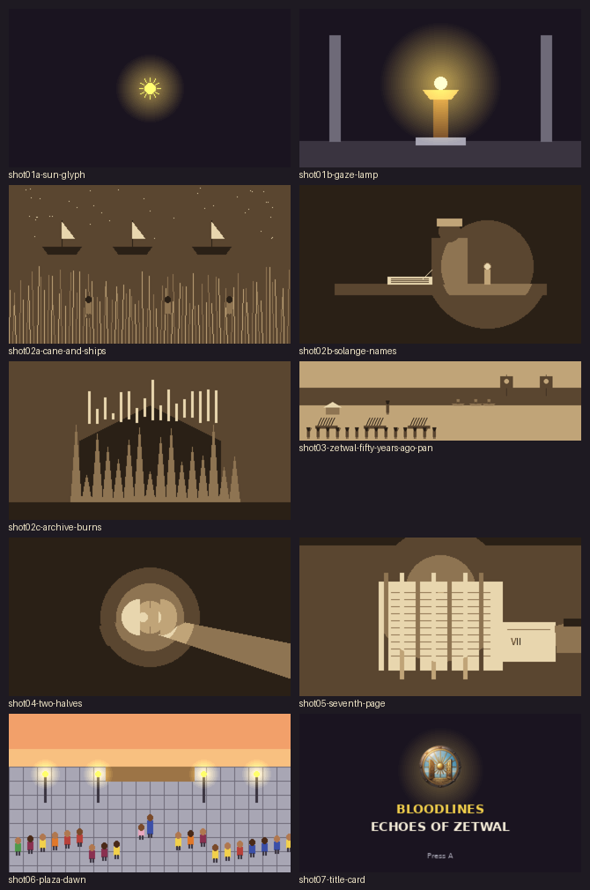

# Intro storyboard: Bloodlines: Echoes of Zetwal

For the animator. Every shot below says exactly what is on screen, how it moves, how long it lasts, what the
narrator says and what the music does. The pictures in `ref/` are **layout frames** (where things sit and what
colour they are), not finished art; the **style references** (the game's own screenshots, sprites and crests)
show the finished look. **Approved by the owner on Oct 16**; being animated now (STORY.md section 2 is the outline
this expands).

---

## The whole piece

| | |
|---|---|
| **Length** | 84 seconds (1008 frames at 12 fps), skippable after the first viewing |
| **Frame** | 320 x 180 pixels, 16:9, shown scaled up with no smoothing (nearest neighbour), so every pixel stays square |
| **Frame rate** | 12 fps for drawn motion (characters, fire, cloth); camera pans and fades move every frame at 24 fps |
| **Style** | 8-bit pixel art matching the game: chunky shapes, a 1-pixel near-black outline (`#1a1420`) around people and objects, three shades per colour, no gradients except light glows, no anti-aliasing |
| **Two looks** | **The past** (shots 2 to 5) is in the game's Echo look: warm sepia, five tones only (below), like the game when Gianna steps into a memory (`ref/game-echo-look.png`, `ref/game-echo-war-room.png`). **The present** (shots 1, 6, 7) is full colour |
| **Text** | Narration appears as subtitles in the lower third: cream (`#f4ecd8`) pixel font, about 8 px tall, centred, on a dark band (`#1a1420` at 60%) 26 px tall, 12 px from the bottom. Fade in over 6 frames, hold, fade out over 6 frames. No dialogue boxes, no speaker names |
| **Voice** | Narration is optional voice-over; the subtitles carry it alone if there is no voice. One narrator, older, warm, unhurried (it is the goddess remembering) |
| **Music** | Chiptune. The main theme, quiet and slow, building to the title. A low brass ostinato (Rael's motif) sits under shot 4, almost hidden. Cues per shot below |

### Palette (the game's own; use only these in the present-day shots)

| Key | Hex | Use | Key | Hex | Use |
|---|---|---|---|---|---|
| outline | `#1a1420` | outlines, night | gold | `#f2d04b` | the sun, the Locket, lamps |
| dark grey | `#3a3440` | shadow | pale gold | `#fff2a0` | glow cores |
| stone | `#a8a6b4` | paving | orange | `#e0782a` | flame, dawn |
| cream | `#f4ecd8` | paper, text | red | `#b8403a` | revolutionary coats, roofs |
| dark brown | `#3e2614` | wood shadow | dark red | `#7a2a26` | coat shadow |
| brown | `#6b4426` | wood | blue | `#3b4fa8` | Gianna's robe |
| light wood | `#c8a46b` | sand, paper edges | pink | `#e8a8c0` | Anissa's dress |
| green | `#4f9a4a` | cane, trees | sky | `#9ad8ff` | day sky, water shine |
| skin deep / mid / light | `#4a2a18` `#7a4a2a` `#b07850` | skin tones | iron | `#4a4a52` | the iron signet |

**The past (sepia), five tones only:** `#2a2016` (darkest), `#5a4630`, `#8e7452`, `#c0a478`, `#e8d6ae` (lightest).
Fire and the Locket's glow may keep a touch of gold `#f2d04b` inside the sepia shots: it is the one colour the
memory keeps.

### The people (match these exactly)

- **Gianna** (present): early twenties, deep brown skin, long dark curly hair, blue robe with gold trim, satchel,
  the Sun Locket at her throat. `ref/gianna-reference.webp`, `ref/gianna-sprites.webp`.
- **Anissa** (present): small, about half Gianna's height, two hair puffs, pink dress, shy: always half behind her
  sister. `ref/anissa-reference.webp`, `ref/anissa-sprites.webp`.
- **Marshal Patricio, young** (the past): dark skin, short black hair, red revolutionary coat with gold trim, a dark
  bicorne hat, epaulettes, a sash. In the game: red coat, bicorne, epaulettes (`ref/game-echo-war-room.png` shows
  him as the player in the memory).
- **Mother Solange** (the past): an old woman in a long purple-grey robe and a grey headwrap, ink on her fingers,
  writing by a small oil lamp.
- **Brasador** (Lord Benny's house): red banners with a gold bull's skull and flames (`ref/crest-brasador.png`).
- **Caona's scouts** (Yaguana, Xaraguá): light brown skin, green tunics, red headbands, in dugout canoes.
- **The Crown**: tall ships with white sails and small red pennants; never a face.

---

## Shot 1: The sun and the lamp (0:00 to 0:10, frames 0 to 119)

| | |
|---|---|
| **Layout frames** | `ref/shot01a-sun-glyph.png` (start), `ref/shot01b-gaze-lamp.png` (end) |
| **Style references** | `ref/game-gaze-lamp-lit.png` (the real lamp, lit) |

**Picture.** Full black (`#1a1420`). At 0:01 a single gold sun symbol (a 13 px disc with 12 short rays) fades in at
the centre of the frame over 1 second, with a soft gold glow about 80 px across that pulses gently (scale 1.0 to
1.1 and back every 2 seconds). At 0:06 the sun slowly drops 6 px and its rays fold inward as the shape of the Gaze
lamp draws itself upward beneath it, line by line (2 rows of pixels per frame): a bronze post, a wide dish, a stone
plinth. The sun becomes the lamp's flame. Two grey stone columns fade in at the far left and right (x 34 to 46 and
274 to 286, from y 30 down to the floor at y 150). The floor is a dark band (`#3a3440`) from y 150 down.

**Camera.** Locked off.

**Narration** (0:02 to 0:08): *"The goddess Elodie wove the realm. She does not rule it. She remembers."*

**Sound and music.** Silence, then one soft bell note when the sun appears (0:01). The theme's first phrase, very
quiet, on a single square-wave voice, from 0:04.

**Transition out.** The lamp's glow swells to fill the frame with pale gold (`#fff2a0`) over the last 12 frames,
then turns to sepia: white-out into shot 2.

---

## Shot 2: The names (0:10 to 0:30, frames 120 to 359)

Three short pictures in the sepia memory look, each fading into the next (12-frame cross-dissolves).

### 2a: The cane and the ships (0:10 to 0:17)

| | |
|---|---|
| **Layout frame** | `ref/shot02a-cane-and-ships.png` |
| **Style reference** | `ref/game-echo-look.png` (the sepia look) |

**Picture.** Night. Sky across the top 70 px with a scatter of single-pixel stars; a thin strip of sea (y 70 to 84);
three tall Crown ships in silhouette on the horizon (white sails catching the moon, tiny red pennants: the pennants
stay gold-tinted, everything else sepia). Below, from y 84 to the bottom, tall cane stalks fill the frame, swaying
in a slow wave (each stalk leans 1 px left and right, offset so a ripple travels across from left to right every
2 seconds). Three workers stand among the cane, only their heads and shoulders visible, still.

**Camera.** Slow push in: the whole picture scales from 100% to 106% over the 7 seconds, centred on the middle
worker.

**Narration** (0:11 to 0:16): *"When the Crown called her people property, the temple wrote down their names."*

### 2b: Mother Solange (0:17 to 0:24)

| | |
|---|---|
| **Layout frame** | `ref/shot02b-solange-names.png` |

**Picture.** A dark room. A heavy wooden table across the lower third (y 112 to 124). Mother Solange sits behind it,
centre-right, in her long robe and headwrap, head bowed, writing in a large open ledger with a quill. A small oil
lamp on the table to the right throws a warm glow (the only gold in the shot) across the page and her hands. The
quill moves along the line in small strokes (4 frames per stroke); every second, a new name appears on the page as
three short dark lines. Shelves of ledgers fade into the dark behind her.

**Camera.** Locked off. The lamp flame flickers (2-frame cycle, 1 px).

**Narration:** none here; the line from 2a lingers until 0:18, then quiet.

### 2c: The first archive burns (0:24 to 0:30)

| | |
|---|---|
| **Layout frame** | `ref/shot02c-archive-burns.png` |

**Picture.** The archive (a stone building with a peaked roof, in black silhouette) in the centre, flames rising in
front of it in jagged tongues (animate the flame tongues on a 3-frame loop, heights changing). Pages lift from the
fire and drift upward (8 to 10 small pale rectangles rising 1 px per frame and tumbling). The sky is the lightest
sepia, glowing.

**Camera.** A slow tilt up following the pages (the picture slides down 20 px over 6 seconds).

**Sound and music.** Crackling fire under the music; the theme drops to a low drone.

**Transition out.** The rising pages turn into falling ash, the ash clears to reveal shot 3 (12-frame dissolve).

---

## Shot 3: Zetwal rises (0:30 to 0:48, frames 360 to 575)

| | |
|---|---|
| **Layout frame** | `ref/shot03-zetwal-fifty-years-ago-pan.png` (a 640 px wide strip; the camera pans across it) |
| **Style references** | `ref/game-echo-look.png` (the tents and barricades in the game's memory), `ref/crest-brasador.png` |

**Picture.** One wide picture, 640 x 180, in sepia. Left to right:
1. **The plaza, fifty years ago** (x 0 to 320): barricades of crossed timbers (three of them, at x 40, 150 and 250),
   a white tent, the paving. A crowd of revolutionaries in red coats along the bottom edge (heads at y 150 to 175),
   a few raising a fist (raise the arm over 3 frames, hold). In the middle, standing taller on a crate,
   **young Marshal Patricio**, red coat, bicorne, one arm raised.
2. **The shore** (x 320 to 450): the sea; three dugout canoes come in to the sand with **Caona's scouts**, green
   tunics and red headbands, paddling (2-frame paddle stroke).
3. **The harbor** (x 450 to 640): two ships arriving with **Brasador banners**: red, with the gold bull's skull and
   flames (keep the gold), the banners rippling (3-frame cloth wave).

**Camera.** A slow pan from left to right across the whole strip: the camera's view (320 wide) starts at x 0 and
ends at x 320, moving at 20 px per second for 16 seconds, with a 1-second hold at each end.

**Narration** (three lines, each about 4 seconds, timed so each names what is on screen):
- 0:31: *"Fifty years ago, Zetwal rose. Marshal Patricio led it."* (Patricio on screen)
- 0:37: *"Caona's scouts found every road."* (the canoes on screen)
- 0:42: *"Lord Benny of Ardencia came by sea to fight beside him."* (the Brasador ships on screen)

**Sound and music.** The theme in full for the first time: drums enter, a march tempo. Crowd shouts, low, under it.

**Transition out.** Hard cut on a drum hit to shot 4.

---

## Shot 4: Two halves of a promise (0:48 to 0:58, frames 576 to 695)

| | |
|---|---|
| **Layout frame** | `ref/shot04-two-halves.png` |

**Picture.** A close-up. Dark background. Two hands come in from the left and right edges at the same height (the
left hand darker, Patricio's; the right hand lighter, Benny's) and meet in the middle over 1.5 seconds. The left
hand holds **half of a gold sun Locket** (a half disc, flat side to the right, a sun engraved on it); the right
holds **half of an iron signet** (a half disc, dark iron, a small red stone). When the flat edges touch (0:51), the
two halves glow: a gold light spreads from the seam (glow grows from 0 to 60 px over 1 second, then holds and
breathes). Keep the gold in this sepia shot. This is the token that Gianna's Locket comes from.

**Camera.** A very slow push in (100% to 110%) from 0:51 to the end.

**Narration** (0:52 to 0:57): *"They sealed the alliance with a token made in two halves."*

**Sound and music.** The music drops to a single held note and a low brass figure underneath (Rael's motif: four
notes, low, repeated twice, almost hidden). A soft chime when the halves touch.

**Transition out.** The glow whites out to sepia paper (12 frames): the paper becomes the page in shot 5.

---

## Shot 5: The seventh page (0:58 to 1:12, frames 696 to 863)

| | |
|---|---|
| **Layout frame** | `ref/shot05-seventh-page.png` |

**Picture.** Looking down at a wooden table. **The Sun Accord** lies in the centre: a thick bound document, its
pages written in neat lines, bound with **seven silk ribbons** across it (alternate red and gold, the only colour
kept besides the glow). Candle glow from the top of the frame.

The action, in order:
1. 0:58 to 1:02: hold on the Accord. Six of the ribbons are tied; the seventh (far right) is loose.
2. 1:02 to 1:07: a hand comes in from the right edge (a gloved hand in a dark sleeve; **never show the arm past the
   wrist, never a face**) and draws one page out from under the others: the page is marked **VII** at the top. It
   slides it out to the right, over 3 seconds, steadily.
3. 1:07 to 1:09: the hand and the page leave the frame. The loose seventh ribbon falls flat onto the table.
4. 1:09 to 1:12: hold on the Accord with six ribbons tied and one lying loose.

**Camera.** Locked off. The candle glow flickers.

**Narration** (1:00 to 1:06): *"The Crown sailed home. The Accord was signed. Six clauses were read aloud."*
(The line ends while the page is still moving. Let the silence after it carry the rest.)

**Sound and music.** Very quiet. Paper sliding. A single low note when the ribbon falls.

**Transition out.** A slow dissolve to colour: the sepia drains into full colour as shot 6 fades up (24 frames).

---

## Shot 6: Fifty years later (1:12 to 1:22, frames 864 to 983)

| | |
|---|---|
| **Layout frame** | `ref/shot06-plaza-dawn.png` |
| **Style reference** | `ref/game-plaza-present.png` (the real plaza: draw it to match this exactly, at dawn) |

**Picture.** Full colour. The Festival Plaza at dawn: the sky across the top in orange and pale gold, the paving, the
stage at the top centre, lanterns lit along the plaza (each with a small gold glow), and a crowd of townspeople in
bright clothes filling the lower half, gently idle (a random 1 px bob every second or two). In the middle of the
crowd, **Gianna** stands looking up toward the stage, and **Anissa** stands half hidden behind her, holding her
robe. Use the game's sprites for both (`ref/gianna-sprites.webp`, `ref/anissa-sprites.webp`).

At 1:18 Anissa peeks out from behind Gianna (moves 3 px right over 4 frames), looks out at the crowd, and tucks
back. Gianna's hand moves to rest on Anissa's shoulder.

**Camera.** A slow descent: start framed on the sky and lanterns (picture shifted 40 px down) and settle on the
crowd and the sisters by 1:17.

**Narration** (1:14 to 1:20): *"Fifty years later, the city still remembers its dead aloud."*

**Sound and music.** Morning birds, the crowd murmuring. The theme returns, gentle and hopeful, building.

**Transition out.** Fade to black over 12 frames.

---

## Shot 7: Title (1:22 to 1:24 and holding, frames 984 onward)

**In the video** (owner decision, Oct 16: keep the animated title). This is the quest's title screen; the game
draws no title of its own. When the video reaches the end, the game loops the last part (the finished title with
**Press A** blinking, and the music's quiet bar) until the player presses a button.

| | |
|---|---|
| **Layout frame** | `ref/shot07-title-card.png` |
| **Style reference** | `ref/crest-kaysoley.png` (the Kay Soley crest, to be redrawn as 32 x 32 pixel art) |

**Picture.** Black. The Kay Soley crest, redrawn as 32 x 32 pixel art in the game's palette, fades in at the centre
of the upper half (centre at x 160, y 56) with a gold glow behind it. Then the title, one line at a time:
**BLOODLINES** in gold (`#f2d04b`) and **ECHOES OF ZETWAL** in cream (`#f4ecd8`), centred, about 12 px tall, in a
bold pixel font, each line appearing letter by letter (2 frames per letter). Then **Press A** in grey
(`#a8a6b4`), small, near the bottom, blinking (on 18 frames, off 6 frames) until the player presses a button.

**Music.** The theme swells to its full statement and resolves on the title, then loops a quiet bar while waiting.

---

## Delivery

- One video file (MP4, H.264), 320 x 180, or scaled up by an exact whole number (1280 x 720 is 4x), with no
  smoothing. Or a PNG frame sequence at 320 x 180 (preferred: the game can play frames itself).
- The music and narration as a separate audio file too, so they can be changed without redrawing.
- Shot 7's title stays in the video and is the quest's title screen (owner decision, Oct 16). Say the frame where
  the title is complete and the loop begins (Press A blinking, the quiet music bar), so the game can repeat it
  until the player presses a button.

## Approved by the owner (Oct 16)

1. The seven shots and their order.
2. The narration lines (all four beats of text above).
3. The sepia look for the past and full colour for the present.
4. Showing the hand that takes the seventh page, but never whose it is.
